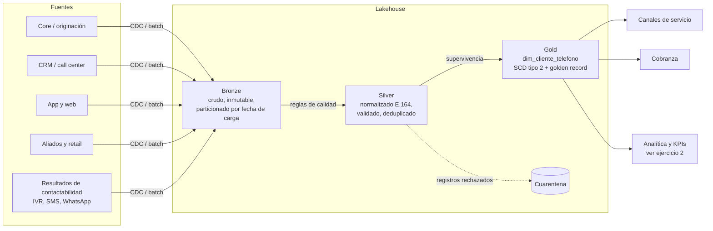

```mermaid
flowchart LR
    D[Desarrollador<br/>rama feature] -->|Pull Request| CI
    subgraph CI[Integración continua]
        L[Lint SQL/Python<br/>sqlfluff, ruff] --> U[Pruebas unitarias<br/>reglas de normalización]
        U --> C[Pruebas de contrato<br/>esquema y expectativas]
        C --> I[Pruebas de integración<br/>dbt build sobre muestra<br/>anonimizada]
        I --> R[Revisión de código<br/>+ aprobación del data owner]
    end
    R -->|merge a main| DEV[Despliegue DEV]
    DEV -->|tag de versión| QA[QA: corrida completa<br/>+ comparación con producción]
    QA -->|aprobación manual| PRD[Producción<br/>blue/green]
    PRD --> M[Monitoreo y alertas]
    M -.->|incidente| RB[Rollback a versión anterior]
```

# Ejercicio 1: dataset confiable de teléfonos de clientes

## Qué se busca

Un solo dataset de teléfonos por cliente, confiable, que puedan consumir servicio al cliente, cobranza y mercadeo sin tener que preguntarse cuál de los cinco números que hay en los sistemas es el bueno. Lo pienso como un *golden record* de contacto.

Para que sirva de verdad, el proceso que lo construye tiene que cumplir cuatro cosas: correr solo y de forma programada; que cualquier cambio (código, reglas, esquema) pase por versionamiento, revisión y pruebas antes de llegar a producción; que cada número publicado se pueda rastrear hasta la fuente, la regla que lo validó y la versión del proceso que lo produjo; y que respete la regulación, en particular la Ley 1581 de 2012 sobre datos personales y la Ley 2300 de 2023, que limita horarios y canales de contacto para cobranza.

## Arquitectura



Uso el esquema de tres capas que ya es bastante estándar en lakehouse:

**Bronze** es la copia fiel de cada fuente, con metadatos técnicos (`fuente`, `fecha_carga`, `id_lote`, `hash_registro`). Solo se inserta, nunca se corrige. La gracia es que si una regla de limpieza estaba mal, se reprocesa desde aquí sin volver a pedirle nada a la fuente.

**Silver** tiene un registro por cliente, teléfono y fuente, ya normalizado y validado. Lo que no pasa las reglas no se descarta: va a una tabla de cuarentena con el motivo, porque un rechazo también es información (si una fuente empieza a mandar basura, quiero enterarme).

**Gold** es `dim_cliente_telefono`, con historia tipo SCD 2 y la marca de cuál es el teléfono principal de cada cliente por tipo. Solo se publica si pasan los quality gates.

En cuanto a tecnología, no me casaría con una: Databricks con Delta o un warehouse SQL, dbt para transformaciones y pruebas, Airflow para orquestar, Great Expectations o las pruebas de dbt para contratos de datos, GitHub Actions para CI/CD y Terraform para la infraestructura. Lo importante es el flujo, no la herramienta.

## Reglas de negocio

### Normalización

Primero se limpia el formato: espacios, guiones, paréntesis, puntos y prefijos de marcación (`+`, `00`, `57`, el `03` viejo, códigos de operador). Luego se lleva todo a E.164, `+57XXXXXXXXXX`, y se clasifica según el plan de numeración de la CRC:

- Móvil: 10 dígitos que empiezan por 3.
- Fijo: 10 dígitos que empiezan por 60 más el indicativo regional (la marcación unificada que rige desde 2021). Todavía llegan muchos fijos de 7 dígitos de antes del cambio; esos se completan con el indicativo de la ciudad del cliente si la conocemos, y si no, a cuarentena.
- Internacional: se conserva si es un E.164 válido de otro país.

### Validaciones

Cada regla tiene código, severidad y su prueba automatizada. Las que tengo claras hoy:

| Código | Regla | Qué pasa si falla |
|---|---|---|
| T01 | Longitud y prefijo válidos para el tipo | Cuarentena |
| T02 | No es un número basura (`3000000000`, `3111111111`, secuencias) | Cuarentena |
| T03 | No está en la lista negra (líneas de la compañía, de pruebas, empleados cargados como cliente) | Cuarentena |
| T04 | No está compartido por más de *k* clientes sin relación | Se publica marcado como `telefono_compartido` |
| T05 | El cliente existe en el maestro | Cuarentena |
| T06 | Hay autorización de contacto vigente (Habeas Data) | Se publica con `apto_contacto = false` |
| T07 | La fuente está actualizada dentro del SLA | Falla el quality gate de frescura |

### Elegir el principal

Cuando un cliente tiene varios números del mismo tipo hay que escoger uno, y prefiero que esa decisión sea una fórmula documentada y no un criterio a ojo:

```
puntaje = peso_fuente            (core 0.4 > app 0.3 > CRM 0.2 > aliados 0.1, por ejemplo)
        + bono_verificado        (OTP o contacto efectivo reciente)
        + recencia               (baja con los días desde la última actualización)
        - penalización_rebote    (SMS no entregado, número equivocado, buzón)
```

El de mayor puntaje es el principal, los demás válidos quedan como secundarios. Si el principal cambia, queda la historia en la SCD 2 (`vigente_desde`, `vigente_hasta`, `es_actual`), que es lo que permite saber qué número se usó en una gestión de hace seis meses.

Un detalle que me parece importante: los resultados de los canales (IVR, SMS, WhatsApp, asesores) entran como una fuente más. Un número que rebota se va degradando y uno que contesta se va fortaleciendo. El dataset mejora solo con el uso.

## CI/CD



### En cada pull request

Corre lint (`sqlfluff`, `ruff`, con pre-commit), las pruebas unitarias de normalización con sus casos borde (`+57 (300) 123-4567`, `0057...`, `6014...`, fijos de 7 dígitos, números basura), las pruebas de contrato (el esquema de entrada y salida está en YAML versionado; si alguien quita una columna o cambia un tipo, el build se rompe antes de llegar a producción), las pruebas de datos (`unique(cliente_id, tipo, es_principal)`, `not_null`, `accepted_values(tipo)`, regex de E.164, umbral de cuarentena) y una corrida de integración sobre una muestra anonimizada y estable, cuyo resultado esperado también está versionado: cualquier diferencia se revisa a mano. Aparte, escaneo de secretos y dependencias. Nunca datos personales reales fuera de producción.

### Despliegue

Tres ambientes, DEV, QA y PRD, con la misma infraestructura en Terraform. El paso a DEV es automático al hacer merge; a QA, con un tag de versión; a PRD, con aprobación manual del data owner (GitHub Environments con revisores obligatorios).

El dato se despliega en modo blue/green: el lote nuevo se escribe en una tabla o partición aparte y solo cuando pasa los quality gates se hace el cambio atómico (una vista que se reapunta, o un swap). Si algo sale mal después, el rollback es volver a la versión anterior con time travel de Delta o Iceberg, más el revert del código.

### Quality gates en producción

| Gate | Para publicar |
|---|---|
| Volumen | Filas dentro de +/- X% de la media móvil de las últimas 7 corridas |
| Cuarentena | Tasa de rechazo por debajo del umbral (5%, digamos) y sin saltos raros |
| Unicidad | Ningún cliente con dos principales del mismo tipo |
| Frescura | Todas las fuentes críticas cargadas dentro del SLA |
| Deriva | La distribución por tipo y fuente no cambió de forma significativa (PSI) |

Si un gate falla no se publica, los consumidores siguen con el último lote bueno y el equipo recibe la alerta (Teams o Slack, más un ticket).

### Mantenimiento

Las listas negras, pesos de fuente y umbrales viven como configuración versionada y se cambian por pull request, no tocando código. Cuando cambia una regla se puede reprocesar la historia desde Bronze con un backfill por rango de fechas. La retención, anonimización y supresión (cuando el titular lo pide) siguen la política de datos personales de la compañía. Y una vez por trimestre revisaría las reglas con negocio usando los KPIs del ejercicio 2.

## Gobierno y seguridad

El dataset tiene un data owner (negocio) y un data steward (calidad) con nombre propio. Las columnas de teléfono son dato personal: cifradas en reposo, enmascaradas para quien no las necesite completas y con acceso auditado. Todo queda en el catálogo (Unity Catalog, DataHub o Purview, el que use la compañía) con descripción, linaje y contrato.

## Tabla de salida (Gold)

| Columna | Qué es |
|---|---|
| `cliente_id` | Identificador del cliente |
| `telefono_e164` | Número normalizado |
| `tipo` | MOVIL, FIJO o INTERNACIONAL |
| `es_principal` | El que ganó la supervivencia para ese cliente y tipo |
| `puntaje_confianza` | Entre 0 y 1, resultado de la fórmula |
| `fuente_origen` | De dónde salió el número |
| `fecha_ultima_verificacion` | Último contacto efectivo u OTP |
| `apto_contacto` | Autorización vigente y número no bloqueado |
| `vigente_desde`, `vigente_hasta`, `es_actual` | Historia SCD 2 |
| `version_pipeline`, `id_lote` | Trazabilidad técnica |
