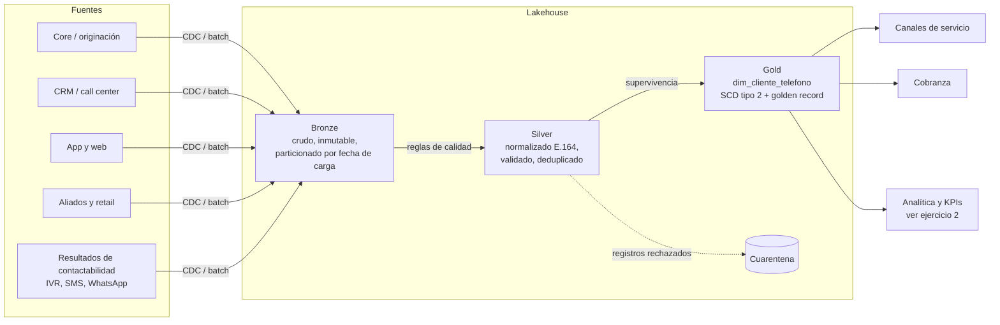

# Ejercicio 1: dataset confiable de teléfonos de clientes (CI/CD)

## 1. Objetivo y alcance

Construir y mantener un dataset único y confiable de números de teléfono por cliente (*golden record* de contacto) que consuman los canales de servicio, cobranza y mercadeo. El proceso debe ser:

- **Automatizado**: corre de forma programada sin intervención manual.
- **Controlado**: todo cambio (código, reglas o esquema) pasa por versionamiento, revisión, pruebas y promoción entre ambientes.
- **Auditable**: cada número publicado se puede rastrear hasta su fuente, la regla que lo validó y la versión del pipeline que lo produjo.
- **Conforme a la regulación**: Ley 1581 de 2012 (Habeas Data), autorización de contacto y Ley 2300 de 2023 (horarios y canales de contacto para cobranza).

## 2. Arquitectura de referencia



| Capa | Contenido | Política |
|---|---|---|
| Bronze | Copia fiel de cada fuente con metadatos técnicos (`fuente`, `fecha_carga`, `id_lote`, `hash_registro`). | Solo inserción (*append-only*). Nunca se corrige. Permite reprocesar. |
| Silver | Un registro por (cliente, teléfono, fuente) normalizado y validado. | Reglas de calidad versionadas. Lo inválido va a cuarentena con el motivo, no se descarta. |
| Gold | `dim_cliente_telefono` con historia (SCD2) y la marca de teléfono principal por cliente y tipo. | Solo se publica si pasan los *quality gates*. |

Tecnología sugerida (intercambiable): Databricks / Spark o un *warehouse* SQL, dbt para las transformaciones y pruebas, Airflow para la orquestación, Great Expectations o pruebas de dbt para contratos de datos y GitHub Actions para CI/CD. Infraestructura declarada en Terraform.

## 3. Reglas de negocio y calidad del dato

### 3.1 Normalización
1. Quitar espacios, guiones, paréntesis, puntos y prefijos de marcación (`+`, `00`, `57`, `03`, códigos de operador de larga distancia).
2. Representar en E.164: `+57XXXXXXXXXX`.
3. Clasificar el tipo según el plan de numeración de Colombia (CRC):
   - **Móvil**: 10 dígitos que empiezan por `3`.
   - **Fijo**: 10 dígitos que empiezan por `60` + indicativo de departamento (marcación unificada desde 2021). Los fijos históricos de 7 dígitos se completan con el indicativo de la ciudad de la dirección del cliente cuando se conoce; si no, van a cuarentena.
   - **Internacional**: se conserva si es E.164 válido para otro país.

### 3.2 Validaciones (cada una con código, severidad y prueba automatizada)

| Código | Regla | Acción |
|---|---|---|
| T01 | Longitud y prefijo válidos según el tipo | Cuarentena |
| T02 | No es un número basura (`3000000000`, `3111111111`, secuencias, un dígito repetido) | Cuarentena |
| T03 | No pertenece a una lista negra (números de la compañía, de pruebas o de empleados registrados como cliente) | Cuarentena |
| T04 | Un mismo número compartido por más de *k* clientes no relacionados | Advertencia: se marca `telefono_compartido` |
| T05 | Cliente existe en el maestro de clientes (integridad referencial) | Cuarentena |
| T06 | Autorización de contacto vigente (Habeas Data) | Se publica con `apto_contacto = false` |
| T07 | Frescura: fuente actualizada dentro del SLA | Falla el *quality gate* si se incumple |

### 3.3 Deduplicación y supervivencia (*golden record*)
Para cada cliente y tipo de teléfono se elige el principal con un puntaje determinístico y documentado:

```
puntaje = peso_fuente                       (p. ej. core 0.4 > app 0.3 > CRM 0.2 > aliados 0.1)
        + bono_verificado                   (OTP o contacto efectivo reciente)
        + recencia                          (decrece con los días desde la última actualización)
        - penalización_rebote               (SMS no entregado, número equivocado, buzón)
```

Los demás números válidos se conservan como secundarios. Si cambia el principal, el cambio queda historizado (SCD2: `vigente_desde`, `vigente_hasta`, `es_actual`).

### 3.4 Retroalimentación de contactabilidad
Los resultados de los canales (IVR, SMS, WhatsApp, asesores) entran como una fuente más. Esto permite degradar números que rebotan y promover los verificados. El dataset mejora con el uso.

## 4. Proceso CI/CD

```mermaid
flowchart LR
    D[Desarrollador<br/>rama feature] -->|Pull Request| CI
    subgraph CI[Integración continua]
        L[Lint SQL/Python<br/>sqlfluff, ruff] --> U[Pruebas unitarias<br/>reglas de normalización]
        U --> C[Pruebas de contrato<br/>esquema y expectativas]
        C --> I[Pruebas de integración<br/>dbt build sobre muestra<br/>anonimizada]
        I --> R[Revisión de código<br/>+ aprobación del data owner]
    end
    R -->|merge a main| DEV[Despliegue DEV]
    DEV -->|tag de versión| QA[QA: corrida completa<br/>+ comparación con producción]
    QA -->|aprobación manual| PRD[Producción<br/>blue/green]
    PRD --> M[Monitoreo y alertas]
    M -.->|incidente| RB[Rollback a versión anterior]
```



### 4.1 Integración continua (en cada Pull Request)
- **Estilo**: `sqlfluff` y `ruff`; *pre-commit hooks*.
- **Pruebas unitarias**: funciones de normalización con casos borde (`+57 (300) 123-4567`, `0057...`, `6014...`, fijos de 7 dígitos, números basura).
- **Contratos de datos**: el esquema de entrada y salida está versionado (YAML). Un cambio incompatible (columna eliminada, tipo distinto) rompe el *build*.
- **Pruebas de datos**: `unique(cliente_id, tipo, es_principal)`, `not_null`, `accepted_values(tipo)`, regex E.164 y umbral de cuarentena, con pruebas de dbt o Great Expectations.
- **Integración**: corrida sobre una muestra anonimizada y estable (*golden sample*); el resultado esperado está versionado y cualquier diferencia se revisa.
- **Seguridad**: escaneo de secretos y de dependencias. No se usan datos personales reales fuera de producción.

### 4.2 Entrega y despliegue continuo
- **Ambientes**: DEV, QA y PRD aislados, con la misma infraestructura definida en Terraform.
- **Versionado**: semántico, para el pipeline y para las reglas. Cada lote publicado guarda la versión que lo generó.
- **Promoción**: DEV es automático; QA es automático con *tag*; PRD requiere aprobación manual del *data owner* (GitHub Environments con *required reviewers*).
- **Despliegue blue/green del dato**: el lote nuevo se escribe en una tabla o partición de preparación. Solo si pasan los *quality gates* se hace el intercambio atómico (vista o *swap*) hacia la tabla consumida.
- **Rollback**: *time travel* (Delta/Iceberg) o volver a apuntar la vista a la versión anterior, más el *revert* del código.

### 4.3 Quality gates en producción (en cada corrida)

| Gate | Condición para publicar |
|---|---|
| Volumen | Filas dentro de +/- X% de la media móvil de 7 corridas |
| Cuarentena | Tasa de rechazo <= umbral (p. ej. 5%) y sin saltos bruscos |
| Unicidad | 0 clientes con más de un teléfono principal por tipo |
| Frescura | Todas las fuentes críticas cargadas dentro del SLA |
| Deriva | Distribución de tipo y fuente sin cambios significativos (PSI) |

Si un gate falla, no se publica: los consumidores siguen leyendo el último lote bueno y se alerta al equipo (Teams o Slack y ticket).

### 4.4 Mantenimiento
- Las reglas (listas negras, pesos de fuente, umbrales) viven como configuración versionada y cambian por Pull Request, no en código.
- Reproceso histórico desde Bronze cuando cambia una regla (*backfill* parametrizado por rango de fechas).
- Ciclo de vida: retención y anonimización según la política de datos personales. Supresión ante solicitud del titular (derecho de supresión).
- Revisión trimestral de reglas con negocio usando los KPIs del ejercicio 2.

## 5. Gobierno y seguridad
- Data owner (negocio) y data steward (calidad) definidos para el dataset.
- Columnas de teléfono clasificadas como dato personal: cifradas en reposo, enmascaradas para roles no autorizados y con accesos auditados.
- Catálogo (Unity Catalog / DataHub / Purview) con la descripción, el linaje y el contrato del dataset.

## 6. Modelo de salida (Gold)

| Columna | Descripción |
|---|---|
| `cliente_id` | Identificador del cliente |
| `telefono_e164` | Número normalizado |
| `tipo` | MOVIL / FIJO / INTERNACIONAL |
| `es_principal` | Ganador de la supervivencia para el cliente y tipo |
| `puntaje_confianza` | 0-1, resultado de la regla de supervivencia |
| `fuente_origen` | Fuente que aportó el número |
| `fecha_ultima_verificacion` | Último contacto efectivo u OTP |
| `apto_contacto` | Autorización vigente y número no bloqueado |
| `vigente_desde` / `vigente_hasta` / `es_actual` | Historia SCD2 |
| `version_pipeline` / `id_lote` | Trazabilidad técnica |
