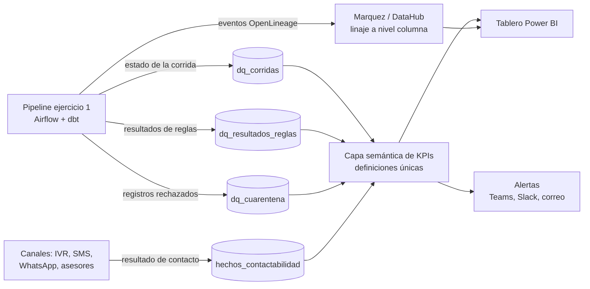

# Ejercicio 2: veeduría de calidad, trazabilidad y KPIs de teléfonos

## La idea

Más que una herramienta nueva, lo que propongo es que el pipeline del ejercicio 1 deje rastro de todo lo que hace, y construir encima de ese rastro. Tres piezas:

1. Una capa de métricas de calidad: cada corrida escribe en tablas propias el resultado de cada regla y de cada gate. Nada se calcula a mano ni en un Excel aparte.
2. Linaje con un estándar abierto (OpenLineage), para poder responder de dónde viene un número, qué regla lo afectó y en qué corrida.
3. Un tablero de autoservicio para negocio (Power BI o Looker) con los KPIs, su tendencia, los desgloses y las alertas, con umbrales acordados con ellos.

## Las tablas

| Tabla | Una fila por | Columnas principales |
|---|---|---|
| `dq_corridas` | ejecución del pipeline | `id_corrida`, `version_pipeline`, `inicio`, `fin`, `estado`, `gates_fallidos` |
| `dq_resultados_reglas` | corrida, regla y fuente | `codigo_regla`, `dimension`, `evaluados`, `fallidos`, `pct_cumplimiento`, `umbral`, `estado` |
| `dq_cuarentena` | registro rechazado | `id_corrida`, `fuente`, `valor_original` (enmascarado), `codigo_regla`, `motivo` |
| `hechos_contactabilidad` | intento de contacto | `cliente_id`, `telefono_e164`, `canal`, `resultado` (efectivo, no contesta, número errado, no entregado), `fecha` |
| `dim_cliente_telefono` | la Gold del ejercicio 1 | lleva `id_lote` y `version_pipeline` para cruzar con la corrida |

Con ese grano cualquier KPI se puede abrir por fuente, regla, tipo de teléfono, segmento, regional o corrida, y desde el indicador bajar hasta el registro y su linaje.

## KPIs

Los separo en tres grupos porque los lee gente distinta.

### Calidad del dato

Sigo las dimensiones de DAMA. Las metas son orientativas; las definitivas se acuerdan con negocio.

| Dimensión | KPI | Cómo se calcula | Meta |
|---|---|---|---|
| Completitud | % clientes activos con al menos un teléfono válido | clientes con teléfono válido / clientes activos | >= 95% |
| Completitud | % clientes con móvil principal | clientes con móvil principal / clientes activos | >= 90% |
| Validez | % números válidos en E.164 | válidos / recibidos | >= 97% |
| Unicidad | % números compartidos por clientes sin relación | números en más de k clientes / números únicos | <= 1% |
| Consistencia | % clientes con teléfono distinto entre fuentes | clientes con conflicto / clientes con 2 o más fuentes | bajando |
| Oportunidad | Frescura por fuente | horas desde la última carga exitosa | <= SLA (24 h, por ejemplo) |
| Oportunidad | % números verificados en los últimos 180 días | verificados recientes / números principales | >= 60% |
| Exactitud | Tasa de contactabilidad | contactos efectivos / intentos | subiendo |
| Exactitud | Tasa de número equivocado | resultados "número errado" / intentos | <= 3% |

La exactitud es la que más me interesa: para un teléfono, el dato es exacto si contesta la persona correcta. Por eso los resultados de contacto son parte del modelo y no un reporte aparte.

### Salud del proceso

Para el equipo de datos: porcentaje de corridas exitosas y de corridas bloqueadas por un gate, la tasa de cuarentena por fuente y regla en el tiempo (sirve para ver qué fuente se está degradando y arreglar en origen), tiempos medios de detección y resolución de incidentes (MTTD, MTTR) y el porcentaje de reglas con dueño y documentación.

### Impacto en el negocio

Para cobranza y mercadeo: el porcentaje de clientes aptos para contacto (número válido y autorización vigente, que es el tamaño real de la base contactable), la contactabilidad por canal y por segmento comparando número principal contra secundario (para decidir por dónde y a qué número salir en una campaña), y el costo evitado, que es cuántos intentos a números inválidos se dejaron de hacer por el costo de cada intento. Ese último es el que justifica el proyecto.

Cada KPI se define una sola vez en la capa semántica, con nombre, fórmula, grano, dueño y umbral, y se publica en el catálogo. Todos los equipos ven el mismo número.

## Linaje

Hay tres niveles. El técnico: Airflow y dbt emiten eventos OpenLineage a Marquez o DataHub, y ahí se ve el recorrido completo de cada columna desde la fuente hasta el tablero. El de registro: cada fila de Gold lleva `id_lote`, `version_pipeline`, `fuente_origen` y `hash_registro`, así que desde el tablero un drill-through muestra la historia del número, la fuente que lo trajo, las reglas que pasó y cómo le ha ido en los contactos. Y el de cambios: como las reglas viven en Git, cualquier movimiento raro de un KPI se puede explicar por una corrida y una versión de código concretas.

## Alertas

| Severidad | Cuándo | Qué se hace |
|---|---|---|
| Crítica | Un gate falla y bloquea la publicación | Aviso inmediato a la guardia de datos y ticket |
| Alta | Un KPI fuera de umbral dos corridas seguidas | Aviso al data steward y al dueño de la fuente |
| Media | Anomalía estadística (z-score o banda de media móvil) | Va en el resumen diario |

Los umbrales son configuración versionada y acordada con negocio. Además de umbrales fijos uso bandas sobre la serie histórica de cada métrica, porque un umbral fijo no ve un cambio de tendencia hasta que ya es tarde.

## El tablero

Cinco páginas: un resumen ejecutivo con el semáforo por dimensión, la base contactable y la contactabilidad con doce meses de tendencia; calidad por fuente, con la cuarentena por regla y fuente para priorizar correcciones en origen; contactabilidad por canal, segmento, regional y antigüedad de la última verificación; operación, con corridas, gates, frescura e incidentes abiertos; y detalle con búsqueda por cliente, con permisos y datos enmascarados, para ver la historia de un número.

Con seguridad a nivel de fila y columna, negocio ve agregados y solo los roles autorizados ven los números completos.
