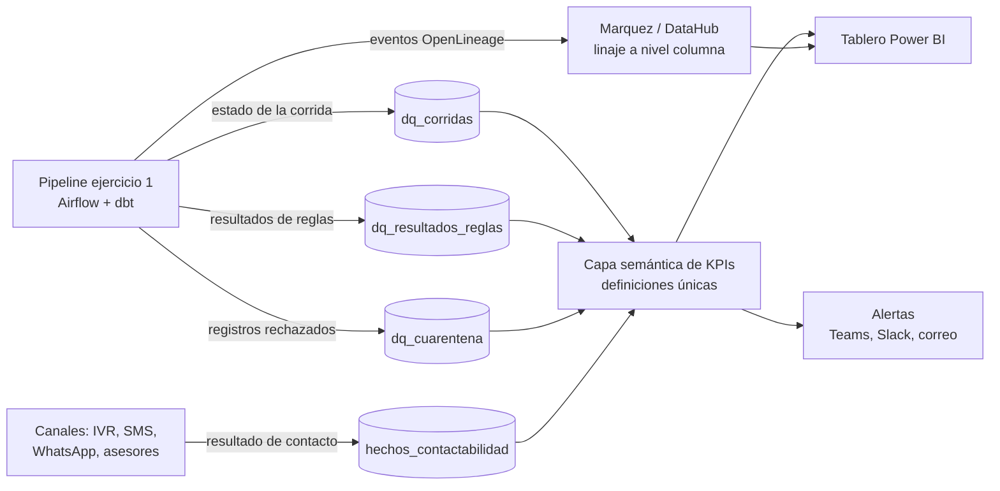

# Ejercicio 2: veeduría de calidad, trazabilidad y KPIs de teléfonos

## 1. Propuesta

Un observatorio de calidad de datos de contacto con tres componentes que se alimentan del pipeline del ejercicio 1:

1. **Capa de métricas de calidad**: cada corrida del pipeline escribe resultados de reglas y métricas en tablas propias. Nada se calcula a mano.
2. **Linaje y trazabilidad**: eventos estándar (OpenLineage) que permiten responder *de dónde viene este número, qué regla lo afectó y en qué corrida*.
3. Tablero de autoservicio y alertas para negocio (Power BI o Looker) con KPIs, tendencias, desgloses y umbrales acordados.

## 2. Modelo de datos de la veeduría

| Tabla | Grano | Columnas principales |
|---|---|---|
| `dq_corridas` | 1 por ejecución | `id_corrida`, `version_pipeline`, `inicio`, `fin`, `estado`, `gates_fallidos` |
| `dq_resultados_reglas` | corrida, regla y fuente | `codigo_regla`, `dimension`, `evaluados`, `fallidos`, `pct_cumplimiento`, `umbral`, `estado` |
| `dq_cuarentena` | registro rechazado | `id_corrida`, `fuente`, `valor_original` (enmascarado), `codigo_regla`, `motivo` |
| `hechos_contactabilidad` | intento de contacto | `cliente_id`, `telefono_e164`, `canal`, `resultado` (efectivo, no contesta, número errado, no entregado), `fecha` |
| `dim_cliente_telefono` | Gold (ejercicio 1) | Con `id_lote` y `version_pipeline` para enlazar con la corrida |

Así cualquier KPI se puede desagregar por fuente, regla, tipo de teléfono, segmento, regional o corrida, y navegar desde el indicador hasta el registro y su linaje.

## 3. KPIs propuestos

### 3.1 Calidad del dato (dimensiones DAMA)

| Dimensión | KPI | Fórmula | Meta orientativa |
|---|---|---|---|
| Completitud | % clientes activos con al menos un teléfono válido | clientes con tel. válido / clientes activos | >= 95% |
| Completitud | % clientes con móvil principal | clientes con móvil principal / clientes activos | >= 90% |
| Validez | % números válidos E.164 | válidos / recibidos | >= 97% |
| Unicidad | % números compartidos por clientes no relacionados | números en > k clientes / números únicos | <= 1% |
| Consistencia | % clientes con teléfono distinto entre fuentes | clientes con conflicto / clientes con >= 2 fuentes | En descenso |
| Oportunidad | Frescura por fuente | horas desde la última carga exitosa | <= SLA (p. ej. 24 h) |
| Oportunidad | % números verificados en los últimos 180 días | verificados recientes / números principales | >= 60% |
| Exactitud | Tasa de contactabilidad | contactos efectivos / intentos | En ascenso |
| Exactitud | Tasa de número equivocado | resultados "número errado" / intentos | <= 3% |

### 3.2 Salud del proceso

| KPI | Uso |
|---|---|
| % corridas exitosas y % corridas bloqueadas por *quality gate* | Estabilidad del pipeline |
| Tasa de cuarentena por fuente y regla (tendencia) | Detectar fuentes que se degradan y enfocar correcciones en origen |
| Tiempo medio de detección y de resolución de incidentes (MTTD / MTTR) | Madurez operativa |
| % reglas con dueño y documentación | Gobierno |

### 3.3 Impacto en el negocio

| KPI | Uso |
|---|---|
| % clientes aptos para contacto (válido + autorización vigente) | Tamaño real de la base contactable |
| Contactabilidad por canal, segmento y número principal frente a secundario | Priorizar canal y número en campañas y cobranza |
| Costo evitado: intentos evitados a números inválidos por el costo de cada intento | Valor económico del dataset |

Cada KPI se define una sola vez en la capa semántica (nombre, fórmula, grano, dueño y umbral) y se publica en el catálogo. Todos los equipos ven el mismo número.

## 4. Trazabilidad (linaje)

- **Linaje técnico**: Airflow y dbt emiten eventos OpenLineage a Marquez o DataHub. El grafo muestra el recorrido completo (fuente, Bronze, Silver, Gold y tablero) a nivel de columna.
- **Linaje de registro**: cada fila Gold lleva `id_lote`, `version_pipeline`, `fuente_origen` y `hash_registro`. Desde el tablero, un *drill-through* muestra la historia SCD2 del número, la fuente que lo aportó, las reglas que evaluó y los resultados de contacto.
- **Linaje de cambios**: como las reglas viven en Git (ejercicio 1), cada cambio de un KPI se puede explicar por una corrida y una versión de código concretas.

## 5. Alertas y operación

| Severidad | Disparador | Acción |
|---|---|---|
| Crítica | *Quality gate* falla y la publicación se bloquea | Notificación inmediata a guardia de datos + ticket |
| Alta | KPI fuera de umbral 2 corridas seguidas | Notificación al *data steward* y al dueño de la fuente |
| Media | Anomalía estadística (z-score o banda de la media móvil) | Resumen diario |

Los umbrales son configuración versionada, acordada con negocio. Las anomalías se detectan con bandas sobre la serie histórica de cada métrica para no depender solo de umbrales fijos.

## 6. Tablero para negocio

1. **Resumen ejecutivo**: semáforo de dimensiones, % base contactable y contactabilidad, con tendencia de 12 meses.
2. **Calidad por fuente**: cuarentena por regla y fuente, para priorizar correcciones en origen.
3. **Contactabilidad**: por canal, segmento, regional y antigüedad de verificación del número.
4. **Operación**: corridas, gates, frescura e incidentes abiertos.
5. **Detalle y linaje**: búsqueda por cliente (con permisos y datos enmascarados) para ver la historia del número.

La seguridad a nivel de fila y columna (RLS/CLS) garantiza que negocio vea agregados y que solo los roles autorizados vean números completos.
